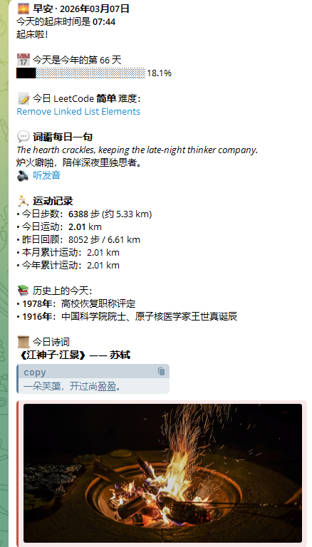

# balabala

🌅 每日自动化报告生成器 - 起床时间、LeetCode、运动数据、历史上的今天、每日诗词



## ✨ 功能特性

- 📝 **LeetCode每日一题** - 自动获取简单难度题目
- 🏃 **运动数据** - 从Garmin Connect自动同步跑步数据
- 📚 **历史上的今天** - 展示历史事件并计算你当时的年龄
- 📜 **每日诗词** - 随机古诗词，附带完整信息
- 💬 **每日一句** - 金山词霸每日英语，包含中英对照和发音
- 📊 **年度进度** - 可视化显示今年已过时间
- 📱 **Telegram推送** - 自动生成精美报告并推送到Telegram

## 📁 项目结构

```
balabala/
├── .env                 # 敏感配置文件（需自行创建，git忽略）
├── .env.example         # 环境变量模板
├── config.yaml          # 非敏感配置文件（需自行创建，git忽略）
├── config.yaml.example  # 配置模板
├── main.py              # 主程序入口
├── requirements.txt     # Python依赖
├── run.bat              # Windows快速运行脚本
├── setup.bat            # Windows安装/配置脚本
├── test_garmin.py       # Garmin登录测试工具
├── test_config.py       # 配置加载测试工具
├── plan.md              # 开发计划
├── progress.md          # 开发进度
├── TROUBLESHOOTING.md   # 故障排除指南
├── MIGRATION.md         # 敏感信息配置迁移指南
├── src/                 # 源代码目录
│   ├── config_loader.py
│   ├── report_generator.py
│   ├── telegram_sender.py
│   └── fetchers/
│       ├── leetcode.py
│       ├── history_today.py
│       ├── poem.py
│       ├── garmin.py
│       └── daily_sentence.py
├── data/                # 报告存储目录
└── logs/                # 日志目录
```

## 🚀 快速开始

### 1. 克隆项目

```bash
git clone https://github.com/lilucpp/balabala.git
cd balabala
```

### 2. 安装依赖

```bash
pip install -r requirements.txt
```

### 3. 配置

**⚠️ 安全提醒**：敏感信息（Token、密码）**不要**直接写入 `config.yaml`！


#### 手动配置

1. **创建 .env 文件**（存储敏感信息）：

```bash
cp .env.example .env  # Linux/Mac
# 或
copy .env.example .env  # Windows
```

编辑 `.env` 文件：

```bash
# ALAPI Token (免费申请 https://www.alapi.cn/)
ALAPI_TOKEN=your_token_here

# Telegram配置
TELEGRAM_BOT_TOKEN=your_bot_token  # 向 @BotFather 发送 /newbot 获取
TELEGRAM_CHAT_ID=your_chat_id      # 向 @userinfobot 发送消息获取

# Garmin Connect账号
GARMIN_USERNAME=your_email@example.com
GARMIN_PASSWORD=your_password
GARMIN_REGION=CN  # 中国区填"CN"，国际区填"US"（默认）
```

2. **创建 config.yaml**（存储非敏感配置）：

```bash
cp config.yaml.example config.yaml
```

编辑 `config.yaml`：

```yaml
# 报告配置
report:
  time: "08:00"              # 定时任务时间
  timezone: "Asia/Shanghai"  # 时区
  show_personal_info: true   # 显示个人信息（年龄计算）
  birth_year: 1989           # 出生年份
```

### 4. 运行测试

```bash
python main.py
```

如果配置正确，你会在Telegram收到一条测试消息！

## ⏰ 配置定时任务

### Windows（任务计划程序）

1. 打开"任务计划程序"（Task Scheduler）
2. 创建基本任务：
   - **名称**: balabala-daily-report
   - **触发器**: 每天 07:00
   - **操作**: 启动程序
   - **程序**: `python`
   - **参数**: `main.py`
   - **起始位置**: 项目完整路径

或者使用提供的PowerShell脚本：

```powershell
# 以管理员身份运行PowerShell
.\scripts\schedule-windows.ps1
```

### Linux/macOS（Cron）

```bash
# 编辑crontab
crontab -e

# 添加以下行（每天7点运行）
0 7 * * * cd /path/to/balabala && /usr/bin/python3 main.py >> logs/cron.log 2>&1
```

### Linux（Systemd）

查看 `scripts/balabala.service` 和 `scripts/balabala.timer` 文件

```bash
sudo cp scripts/balabala.service /etc/systemd/system/
sudo cp scripts/balabala.timer /etc/systemd/system/
sudo systemctl daemon-reload
sudo systemctl enable balabala.timer
sudo systemctl start balabala.timer
```

## 📊 报告示例

[​](https://staticedu-wps-cache.iciba.com/image/d964eff5a013837773e49a5cf4074651.png)  
🌅 *早安 · 2026年03月07日*  
今天的起床时间是 *07:44*  
起床啦！  

📅 今天是今年的第 66 天  

███░░░░░░░░░░░░░░░░░ 18\.1%

📝 今日 LeetCode *简单* 难度：  
[Remove Linked List Elements](https://leetcode.cn/problems/remove-linked-list-elements/)

💬 *词霸每日一句*  
_The hearth crackles, keeping the late\-night thinker company\._  
炉火噼啪，陪伴深夜里独思者。  
[🔊 听发音](https://staticedu-wps-cache.iciba.com/audio/fc1bbfcc6d8279bf118cb80b9a157c77.mp3)

🏃 *运动记录*

• 今日步数：*6388* 步 \(约 5\.33 km\)  
• 今日运动：*2\.01* km  
• 昨日回顾：8052 步 / 6\.61 km  
• 本月累计运动：2\.01 km  
• 今年累计运动：2\.01 km  

📚 历史上的今天：  
• *1978年*：高校恢复职称评定  
• *1916年*：中国科学院院士、原子核医学家王世真诞辰  

📜 今日诗词  
*《江神子·江景》—— 苏轼*  
```
一朵芙蕖，开过尚盈盈。
```


## 🔧 技术栈

- **Python 3.8+**
- **requests** - HTTP请求
- **python-telegram-bot** - Telegram Bot API
- **garminconnect** - Garmin Connect数据获取
- **pyyaml** - YAML配置解析
- **loguru** - 日志记录

## 📡 数据源

| 数据源 | 方式 | 认证 |
|--------|------|------|
| LeetCode | GraphQL API | 无需 |
| 历史上的今天 | ALAPI | Token（免费） |
| 每日诗词 | ALAPI | Token（免费） |
| Garmin | garminconnect库 | 账号密码 |
| Telegram | Bot API | Bot Token（免费） |

## 📝 日志

日志文件保存在 `logs/balabala.log`，包含详细运行信息：
- 数据获取状态
- API调用结果
- 错误信息
- 发送状态

## 🐛 故障排除

### 1. 依赖安装失败

```bash
# 使用国内镜像加速
pip install -r requirements.txt -i https://pypi.tuna.tsinghua.edu.cn/simple
```

### 2. Telegram发送失败

- 检查Bot Token是否正确
- 确认已向Bot发送 `/start` 消息
- 检查Chat ID格式（通常为数字，可能需要加负号）

### 3. Garmin登录失败

- 检查账号密码
- 如果开启了两步验证(2FA)，需要先在Garmin网站登录一次
- Garmin可能会封禁频繁登录，建议减少测试频率
- **使用测试脚本诊断**: `python test_garmin.py`
- **中国区用户**: 确认配置文件中设置了 `region: "CN"`

查看 `TROUBLESHOOTING.md` 获取更详细的解决方案。

### 4. ALAPI配额用完

- 免费版有调用限制
- 如需更多配额，可购买付费版

## 🤝 贡献

欢迎提交Issue和PR！

## 📄 许可证

MIT License

## 🙏 致谢

- [ALAPI](https://www.alapi.cn/) - 历史上的今天和诗词API
- [LeetCode](https://leetcode.cn/) - 每日一题
- [Garmin](https://connect.garmin.com/) - 运动数据
- [python-telegram-bot](https://github.com/python-telegram-bot/python-telegram-bot) - Telegram Bot库
- [garminconnect](https://github.com/cyberjunky/python-garminconnect) - Garmin Connect库
